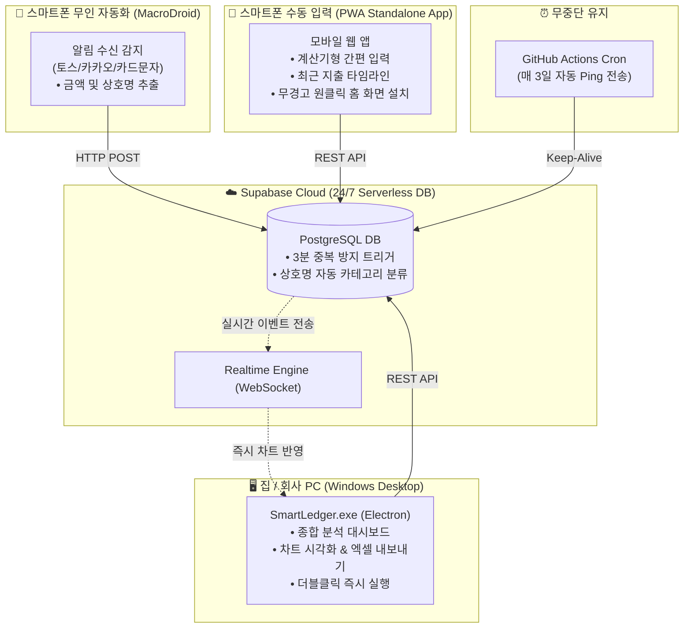

# 💰 스마트 원격 가계부 (Smart Ledger)


> **24시간 무중단 실시간 연동 스마트 가계부 시스템**  
> 집 PC 서버를 켤 필요 없이, **스마트폰 무인 자동 등록**, **PWA 모바일 앱**, **PC 윈도우 포터블 실행 파일** 어디서나 실시간으로 동기화되어 사용할 수 있는 개인 가계부입니다.

---

## ⚡ 바로가기 및 다운로드

| 구분 | 링크 | 설명 |
| :--- | :--- | :--- |
| **📱 스마트폰 PWA 웹앱 접속** | **[https://aud9855.github.io/smart-ledger/](https://aud9855.github.io/smart-ledger/)** | **보안 경고 0건 (추천 ⭐)**, 브라우저 접속 후 [홈 화면에 추가] 시 앱 설치 |
| **🤖 안드로이드 설치 APK** | **[SmartLedger.apk 다운로드 (v1.0.2)](https://github.com/aud9855/smart-ledger/releases/download/v1.0.2/SmartLedger.apk)** | 신규 지갑 아이콘 적용 네이티브 APK 설치 파일 (5.9MB) |
| **🖥️ PC용 실행 프로그램** | **[SmartLedger.exe 다운로드 (v1.0.2)](https://github.com/aud9855/smart-ledger/releases/download/v1.0.2/SmartLedger.exe)** | 설치 불필요, 다운로드 후 더블클릭 즉시 실행 (Windows 64-bit, 신규 전용 아이콘) |
| **🤖 무인 자동화 가이드** | **[MacroDroid 설정 가이드](./MACRODROID_GUIDE.md)** | 토스/카드 알림 수신 시 폰 안 켜도 자동 등록 (3분 중복 제거 포함) |
| **📦 GitHub 통합 릴리즈** | **[GitHub Releases](https://github.com/aud9855/smart-ledger/releases)** | 최신 릴리즈 및 파일 배포 내역 |
| **☁️ Supabase 콘솔** | **[Supabase Project Console](https://supabase.com/dashboard/project/uyafrivmhhyzicbnkhet)** | 가계부 클라우드 데이터베이스 콘솔 |

---

## ✨ 핵심 기능

* **🤖 무인 자동 결제 등록 (MacroDroid):**
  * 결제 알림(토스, 카카오페이, 카드 승인 문자) 도착 시 **폰을 켜지 않아도 0.1초 만에 DB 자동 적재**
  * **3분 타임 윈도우 중복 방지:** 토스 알림과 카드사 문자가 동시 도착해도 1건만 깔끔히 저장
  * **상호명 기반 자동 카테고리 매핑:** 스타벅스/메가커피→카페, 배민/식당→식비, CU/GS25→편의점/마트 자동 분류
* **📱 모바일 3초 간편 수동 입력 (PWA):**
  * 계산기형 전용 숫자 키패드 및 `+1만`, `+5만`, `+10만` 퀵 버튼
  * 우체국, 신한, 카카오페이, 현금 원터치 결제수단 선택
  * 계좌별 현재 잔액(총합 + 계좌별) 조회 — `schema_accounts.sql` 실행 필요
  * 일별/최근 내역 타임라인 피드
* **🖥️ PC 종합 분석 대시보드 (Desktop):**
  * **상단 KPI 4종:** 이번 달 총 지출, 총 수입, 순 잔액, 목표 예산 사용률 프로그레스 바
  * **카테고리별 소비 분석:** Recharts 인터랙티브 도넛 차트 및 지출 랭킹
  * **일별 소비 추이:** 일자별 지출/수입 바 차트 (소비 집중일 파악)
  * **전체 거래내역 테이블:** 다중 필터(유형, 결제수단), 검색, 수정/삭제, **엑셀(CSV) 내보내기**
* **⚡ 초고속 실시간(Realtime) 동기화:**
  * 스마트폰에서 지출을 등록하는 즉시, 켜져 있는 PC 프로그램 화면에 새로고침 없이 1초 만에 그래프와 통계가 자동 갱신됩니다.
* **🔒 로컬 보안 PIN 잠금:**
  * 4자리 숫자 PIN 번호 잠금 기능으로 개인 금융 데이터 보호.
* **⏰ 7일 미사용 자동 일시정지(Pause) 방지:**
  * Supabase 무료 티어의 7일 미사용 수면 정책을 방지하기 위해, GitHub Actions가 매 3일마다 자동으로 핑을 보내 24시간 365일 무중단 유지.

---

## 🛠️ 시스템 아키텍처



---

## 🛠️ 개발 언어 및 기술 스택 (Tech Stack & Versions)

이 프로젝트는 최신 모던 웹 표준 기술과 클라우드 서버리스 아키텍처를 결합하여 제작되었습니다:

### 1. 프론트엔드 (Frontend)
| 기술 / 라이브러리 | 버전 | 역할 및 특징 |
| :--- | :--- | :--- |
| **React** | `v19.0.0` | 최신 컴포넌트 기반 반응형 UI 및 선언적 상태 관리 |
| **TypeScript** | `v5.7.3` | 정적 타입 검사 및 런타임 오류 방지, 강력한 코드 안정성 |
| **Vite** | `v6.1.0` | Rollup 기반의 차세대 초고속 번들러 및 HMR 개발 환경 |
| **Tailwind CSS** | `v3.4.17` | 유틸리티 퍼스트 반응형 스타일링 (PC & 모바일 노치/다이나믹 아일랜드 최적화) |
| **Recharts** | `v2.15.1` | 카테고리별 도넛 차트 및 일별 소비 추이 반응형 통계 시각화 |
| **Lucide React** | `v0.475.0` | 트리쉐이킹을 지원하는 경량 고품질 모던 벡터 아이콘 팩 |
| **Pretendard** | `v1.3.9` | 모든 디바이스에서 또렷하게 렌더링되는 프리미엄 한글 웹폰트 |

### 2. 백엔드 & 클라우드 데이터베이스 (Backend & Cloud DB)
| 기술 / 서비스 | 버전 | 역할 및 특징 |
| :--- | :--- | :--- |
| **Supabase Cloud** | `@supabase/supabase-js v2.49.1` | 24/7 무중단 서버리스 REST API 및 실시간 WebSocket 동기화 엔진 |
| **PostgreSQL** | `v15+` | 완전한 ACID 트랜잭션과 무결성을 보장하는 클라우드 관계형 DB |
| **PL/pgSQL Trigger** | Native SQL | **3분 타임 윈도우 중복 결제 자동 제거** 및 상호명 기반 자동 카테고리 분류 |

### 3. 크로스 플랫폼 & 배포 (Cross-Platform)
| 플랫폼 / 도구 | 버전 | 역할 및 특징 |
| :--- | :--- | :--- |
| **Progressive Web App (PWA)** | Service Worker `v2` | 브라우저 보안 경고 0건, 원클릭 홈 화면 단독 앱 설치 및 자동 캐시 갱신 |
| **Electron** | `v44.7.0` | Windows 64-bit 더블클릭 단일 포터블 실행 파일 (`SmartLedger.exe`) 패키징 |
| **electron-builder** | `v26.15.3` | 전용 다중 해상도 아이콘(`.ico`) 각인 및 코드 무결성 빌드 |
| **Capacitor Android** | `v8.5.3` | 안드로이드 14/15 호환 네이티브 앱 (`SmartLedger.apk`) 래퍼 |
| **GitHub Pages** | 24/7 HTTPS | PWA 실시간 호스팅 및 GitHub Actions CI/CD 무중단 자동 배포 |

### 4. 무인 스마트 자동화 (Smart Automation)
| 도구 / 기능 | 환경 | 역할 및 특징 |
| :--- | :--- | :--- |
| **MacroDroid** | Android (무료) | 화면 꺼짐 상태에서도 **토스(Toss) 결제 알림** 감지 시 0.1초 Supabase REST API 직송 |
| **GitHub Actions Cron** | v4 Workflows | 3일 주기 자동 Ping 전송으로 무료 티어 Supabase DB 영구 활성(잠듦 방지) 유지 |

---

## 💻 개발 및 빌드 명령어

Node.js 환경에서 직접 소스코드를 빌드하거나 실행할 때 사용합니다:

```bash
# 1. 저장소 클론 및 패키지 설치
git clone https://github.com/aud9855/smart-ledger.git
cd smart-ledger
npm install

# 2. 로컬 개발 서버 실행
npm run dev

# 3. 웹 및 PWA 프로덕션 빌드
npm run build

# 4. Windows 포터블 EXE 파일 빌드
npm run build:exe
```

---

## 🗄️ 데이터베이스 스키마 및 트리거 (Supabase SQL)

1. **기본 스키마:** [`schema.sql`](./schema.sql) - 테이블 및 기본 15종 카테고리 생성
2. **자동화 스키마:** [`schema_automation.sql`](./schema_automation.sql) - 3분 중복 방지 및 상호명 자동 카테고리 분류 트리거
